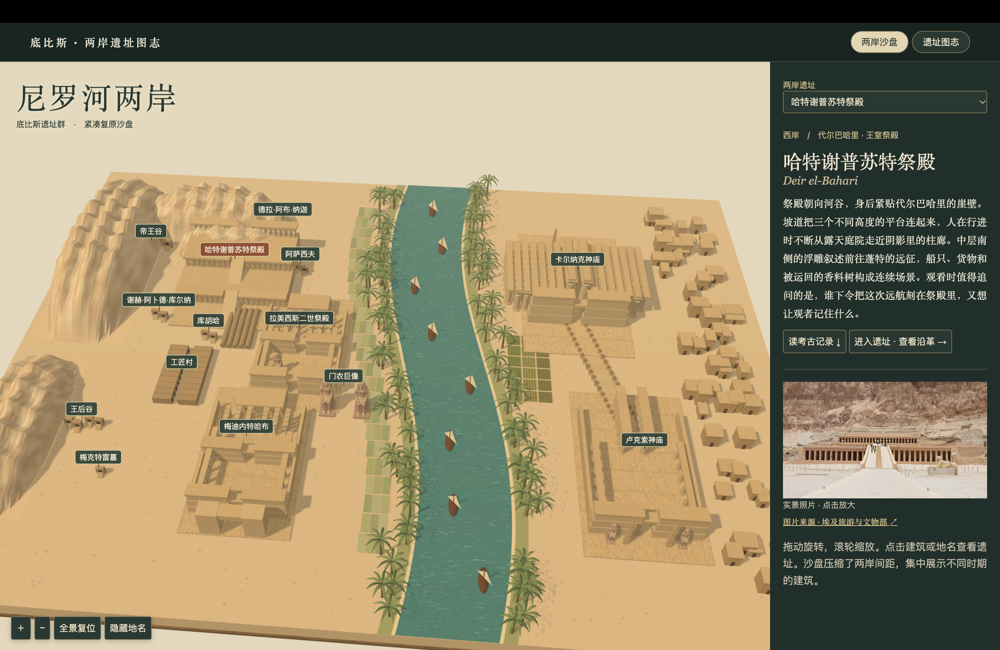
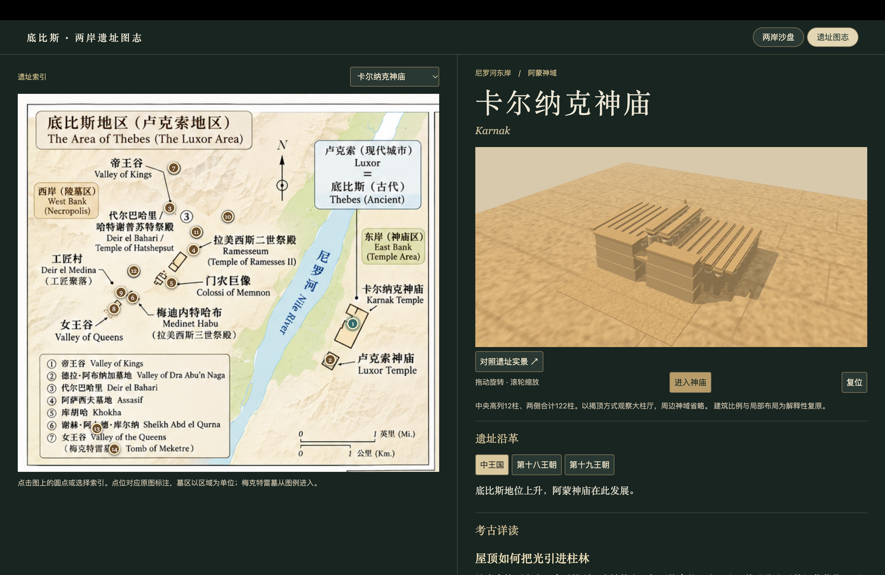

# 卢克索遗址图志

沿尼罗河探索古底比斯的 14 处遗址。从两岸的三维沙盘选一个地标，可以走进神庙、对照遗址实景，或展开测绘图，查看图坦卡蒙墓的墓室和宝库如何相连。

**[打开在线图志](https://luxor-theban-atlas.abuzz-cove-1643.chatgpt.site)**

## 从哪里开始

- **看两岸布局**　在沙盘中拖动旋转，滚轮或加减按钮缩放。点击建筑或地名可查看遗址记录。
- **走进神庙**　选择卡尔纳克神庙，点击「进入遗址」及「进入神庙」。用 WASD 或方向键移动，拖动环视；触屏可使用画面上的方向按钮。
- **读地下空间**　选择帝王谷，打开 KV62 实测图，对照平面与剖面寻找入口、前室、墓室和宝库。

## 离线使用

下载仓库中的 `index.html`，用支持 WebGL 的桌面浏览器打开即可。Three.js、模型生成代码、照片、地图和中文解读均嵌在这一个文件内，无需安装依赖；阅读链接指向的外部考古资料时需要联网。

## 复原说明与资料

沙盘压缩了遗址间距，便于同时观察两岸。建筑以研究资料为依据作解释性复原，比例、材质和局部细节经过简化。实景照片、实测图和三维示意在页面中分别标注，各篇考古解读附有对应出处。

- 遗址概况与实景照片见[埃及旅游与文物部](https://egymonuments.gov.eg/en/world-heritage/ancient-thebes-and-its-necropolis)。
- 图坦卡蒙墓平面与剖面见[底比斯测绘项目 KV62 实测图](https://thebanmappingproject.com/sites/default/files/plans/KV62_1.pdf)。
- 卡尔纳克大柱厅的柱式与采光见[孟菲斯大学大柱厅研究项目](https://www.memphis.edu/hypostyle/about_hall/)。
